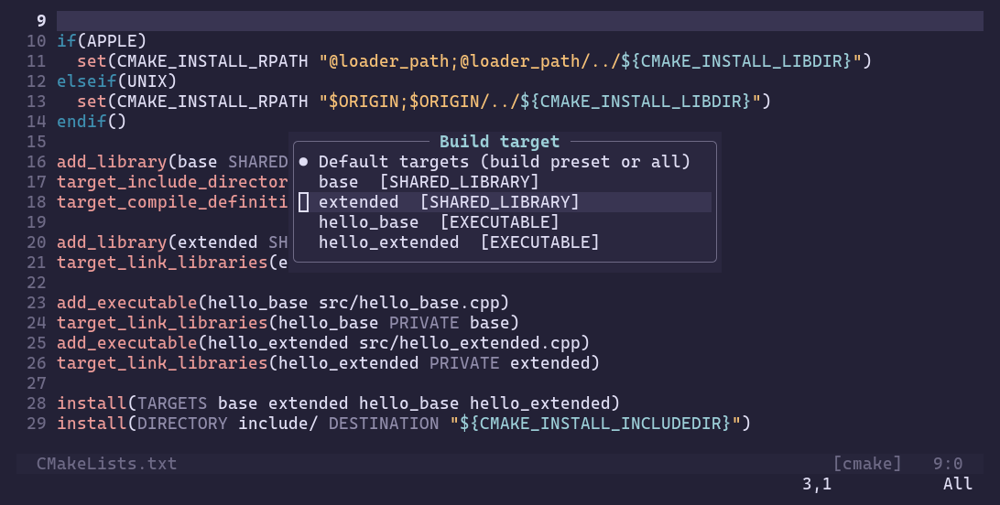
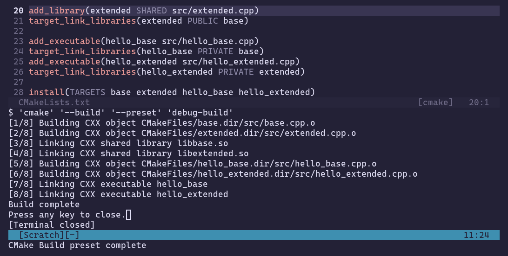

# NeoCMake

NeoCMake brings the VS Code CMake Tools workflow into Neovim. Pick a preset, choose a target, and build, run, or install it from the editor. You can keep a shared library selected for builds while running the executable that uses it. NeoCMake remembers both selections per project.



CMake supplies the target list and executable paths through its File API. NeoCMake sends the active build's compiler flags to clangd and turns compiler errors into Neovim diagnostics and jumpable quickfix entries.

## Install

The repository is private. Use a Git account with read access, or point lazy.nvim at a checkout you already have.

You'll need **Neovim 0.12 or newer**, **CMake 3.23 or newer**, a C++ toolchain, and the build tool your project uses. The example uses Ninja. For completion, hover, and live diagnostics, install clangd and enable it in your Neovim LSP configuration.

### lazy.nvim or LazyVim

Add this plugin spec. In LazyVim, save it as `lua/plugins/neocmake.lua` under your Neovim config directory. Run `:echo stdpath('config')` to find that directory on any platform.

```lua
return {
  "gpioloco/NeovimCmake",
  main = "neocmake",
  lazy = false,
  opts = { prefix = "<leader>m" },
}
```

Restart Neovim and run `:Lazy install`. To load a local checkout, replace `"gpioloco/NeovimCmake"` with `dir = vim.fn.expand("~/NeovimCmake")`.

### Built-in Neovim package manager

Add this to your `init.lua`, restart Neovim, and confirm the initial install.

```lua
vim.pack.add({ "https://github.com/gpioloco/NeovimCmake" })
```

The plugin registers its commands and default mappings automatically. To verify either installation, open a project's `CMakeLists.txt` and run `:CMakeStatus`.

### Windows toolchain

For **MSVC + Ninja**, install the **Desktop development with C++** workload from Visual Studio Build Tools and make sure `cmake` and `ninja` are on your path. Start Neovim from the **x64 Native Tools Command Prompt** so CMake inherits the compiler, linker, and Windows SDK environment. With MinGW-w64, start Neovim from a shell that has the toolchain’s `bin` directory on `PATH` so launched programs can find their runtime DLLs. [Microsoft's command-line setup guide](https://learn.microsoft.com/en-us/cpp/build/building-on-the-command-line)

Use a **Ninja**, **Ninja Multi-Config**, or **Makefiles** generator when you want CMake to produce `compile_commands.json` for clangd. The Visual Studio generator supports configuration-specific builds, but CMake only implements compilation database export for Ninja and Makefiles. [CMake compilation database support](https://cmake.org/cmake/help/latest/variable/CMAKE_EXPORT_COMPILE_COMMANDS.html)

## Try it on the example

Once the plugin is installed, open the bundled project from a checkout.

```sh
git clone https://github.com/gpioloco/NeovimCmake.git
cd NeovimCmake/examples/workflow
nvim CMakeLists.txt
```

In Normal mode, press each key in sequence. With Space as your leader, `<leader>mp` means **Space → m → p**.

1. **Configure** with `<leader>mp`. Choose **Debug** and press Enter. When configuration finishes, press any key to dismiss the output.
2. **Build a library** with `<leader>mt`. Choose **base**, then press `<leader>mb` to compile it.
3. **Run an application** with `<leader>ml`. Choose **hello_extended**, then press `<leader>mr`. NeoCMake builds its dependencies and opens a terminal where you'll see `extended: 42`.
4. **Install** with `<leader>mi`. Look in `stage/debug/` for both applications, both libraries, and their headers. On Windows the DLLs sit beside the executables in `bin/`.



Press any key in the build or configure terminal to hide it, even while the job is running. Reopen the full log with `<leader>mo` or `:CMakeLog`. A launched program has its own interactive terminal and accepts keyboard input.

## Command reference

All mappings share the configurable prefix `<leader>m`. The **Key** column gives the next key. In a picker, move with `j` / `k` or the arrows, search with `/`, confirm with Enter, and cancel with Escape.

| Key | Command | Action |
| --- | --- | --- |
| `p` | `:CMakeConfigurePreset` | Choose and apply a configure preset |
| `c` | `:CMakeConfigure` | Reconfigure the project and refresh its targets |
| `P` | `:CMakeBuildPreset` | Choose a build preset compatible with the configure preset |
| `k` | `:CMakeBuildConfiguration` | Choose a build configuration such as Debug or Release |
| `t` | `:CMakeBuildTarget` | Choose a target or restore the preset's default targets |
| `b` | `:CMakeBuild` | Build the selection |
| `i` | `:CMakeBuildInstall [prefix]` | Build the default targets and install them |
| `l` | `:CMakeRunTarget` | Choose the executable to run |
| `r` | `:CMakeRun [args...]` | Build and launch that executable |
| `o` | `:CMakeBuildLog` | Reopen the project output |
| `x` | `:CMakeBuildStop` | Stop the current CMake job |
| `s` | `:CMakeStatus` | Show the active presets, targets, build directory, and configuration |

**Preset or configuration?** Use `p` to switch the whole configure preset, including its build tree, install prefix, and environment. Use `k` to change the configuration within that tree. For a single-config generator this sets `CMAKE_BUILD_TYPE` and reconfigures. For a multi-config generator the choice applies to build, run, install, and clangd. Selecting a build preset again restores its default multi-config selection.

**Arguments and paths.** Programs start in the project root with the configure preset's environment. For an argument containing a space, use `:CMakeRun --name Ada\ Lovelace`. To override the install prefix for one install, use `:CMakeBuildInstall ./stage/local`.

## clangd and build diagnostics

NeoCMake enables `CMAKE_EXPORT_COMPILE_COMMANDS` when configuring and publishes the active `compile_commands.json` at the project root. Switching configurations updates open clangd buffers. If you already maintain a root database or symlink, NeoCMake preserves it and points clangd at the selected build database.

After a failed build, use `:copen` to see the compiler messages and `:cnext` to jump to a source location. A successful rebuild clears stale build diagnostics. Linker errors and other messages without a source location remain available in the build log.

## Configuration

Pass these options through `opts` in lazy.nvim or call `setup` after `vim.pack.add`.

```lua
require("neocmake").setup({
  prefix = "<leader>m",     -- Set to false to use commands only
  cmake = "cmake",          -- Executable on PATH or a full path (cmake.exe on Windows)
  build_dir = "build",      -- Build directory for projects without presets
  save_before_build = true, -- Save modified project buffers before configure/build
  -- select = vim.ui.select, -- Use your configured UI picker
})
```

## Verification

From the repository root, the integration test drives the pickers, builds and runs both executables, installs them, and checks a compiler error and its recovery.

```sh
nvim --headless -u NONE -i NONE -c "luafile tests/integration.lua"
```

To include your configured clangd in the test, omit `-u NONE` and set `NEOCMAKE_LOCAL_LSP=1` in the environment.

The full workflow has been exercised on Linux, including a clangd hover check against the newly selected preset. The Windows sample was cross-built and installed as x64 PE executables and DLLs with LLVM-MinGW. The plugin's File API lookup located the `.exe`, and the binaries' import tables confirmed the dependency chain. Native Windows terminal interaction and an MSVC build still need verification on a Windows host.
